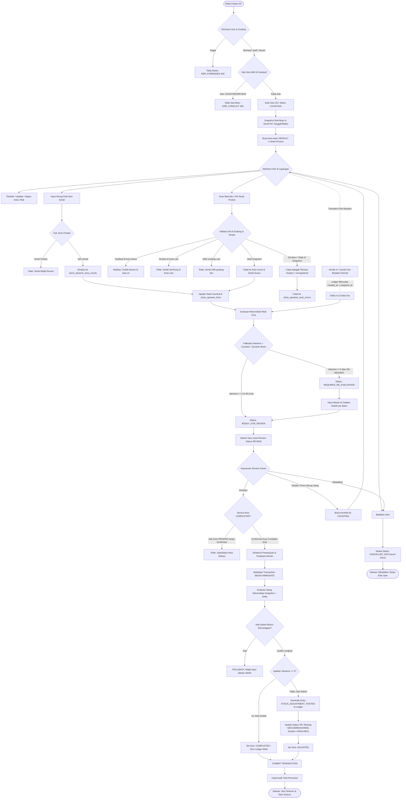

# DOKUMENTASI AUDIT IMPLEMENTASI AKTUAL ALUR STOCK OPNAME (SO)
**DocuFlow Inventory Multi-Owner V2.4.1**  
**Tanggal Audit:** 19 Oktober 2026  
**Status Audit Dokumen:** SELESAI (Audit & Dokumentasi Saja — Tidak Ada Modifikasi Kode / Database)

---

## DAFTAR ISI
1. [Ringkasan Eksekutif & Prinsip Desain](#1-ringkasan-eksekutif--prinsip-desain)
2. [Diagram Alur End-to-End (Mermaid)](#2-diagram-alur-end-to-end-mermaid)
3. [Dokumentasi Rinci Setiap Tahapan](#3-dokumentasi-rinci-setiap-tahapan)
   - [A. Pembuatan Sesi (Session Initiation)](#a-pembuatan-sesi-session-initiation)
   - [B. Snapshot Stok (Stock Freezing)](#b-snapshot-stok-stock-freezing)
   - [C. Penghitungan Stok Fisik (Physical Counting)](#c-penghitungan-stok-fisik-physical-counting)
   - [D. Transaksi Konkuren Selama SO (Dynamic Book Stock)](#d-transaksi-konkuren-selama-so-dynamic-book-stock)
   - [E. Rekonsiliasi Stok & Evaluasi Real-Time](#e-rekonsiliasi-stok--evaluasi-real-time)
   - [F. Investigasi Selisih & Pengajuan Review](#f-investigasi-selisih--pengajuan-review)
   - [G. Persetujuan Owner & Finalisasi Ledger](#g-persetujuan-owner--finalisasi-ledger)
   - [H. Ekspor Excel & Pelaporan OpenXML](#h-ekspor-excel--pelaporan-openxml)
   - [I. Pembatalan Sesi & Penanganan Error](#i-pembatalan-sesi--penanganan-error)
4. [Tabel Transisi Status Aktual](#4-tabel-transisi-status-aktual)
5. [Matriks Hak Akses (Role-Based Access Control)](#5-matriks-hak-akses-role-based-access-control)
6. [Peta Arsitektur End-to-End (UI → Action/API → Repo → DB)](#6-peta-arsitektur-end-to-end-ui--actionapi--repo--db)
7. [Formula Matematis Stok, Selisih, dan Adjustment](#7-formula-matematis-stok-selisih-dan-adjustment)
8. [Idempotensi, Atomisitas Transaksi, dan Rollback](#8-idempotensi-atomisitas-transaksi-dan-rollback)
9. [Audit Isolasi Multi-Tenant, Gudang, dan Catatan RLS Supabase Production](#9-audit-isolasi-multi-tenant-gudang-dan-catatan-rls-supabase-production)
10. [Daftar Risiko, Keterbatasan, dan Fitur yang Belum Terverifikasi](#10-daftar-risiko-keterbatasan-dan-fitur-yang-belum-terverifikasi)
11. [Katalog Referensi Kode Sumber dan Test Suites](#11-katalog-referensi-kode-sumber-dan-test-suites)
12. [Kesimpulan Akhir Audit](#12-kesimpulan-akhir-audit)

---

## 1. Ringkasan Eksekutif & Prinsip Desain

Implementasi modul Stock Opname (SO) pada DocuFlow V2.4.1 telah selesai diimplementasikan melalui **Phase 2 hingga Phase 7**. Modul ini dirancang dengan prinsip tata kelola inventaris yang ketat:

1. **Invarian Ledger:** Pembukaan sesi SO, input hitung manual, pemindaian barcode serial, penambahan area, evaluasi rekonsiliasi, pengajuan review, dan export Excel **TIDAK PERNAH MENULIS KE `inventory_ledger`**. Ledger hanya dimutasi pada saat **Finalisasi Persetujuan Owner** (`approveAndPostStockOpnameAdjustment`).
2. **Imutabilitas Snapshot vs Dynamic Book Stock:** Stok buku saat sesi dimulai dibekukan di tabel `stock_opname_lines` (`snapshot_qty`) dan `stock_opname_serial_snapshots`. Transaksi barang masuk (Goods In) atau barang keluar (Goods Out) yang terjadi selama sesi SO berlangsung tidak mengubah snapshot, melainkan dihitung secara dinamis saat rekonsiliasi:  
   $$\text{Dynamic Book Qty} = \text{Snapshot Qty} + \Delta\text{In} - \Delta\text{Out}$$
3. **Pemisahan Tracking Produk (Serial vs Non-Serial):**
   - **Produk Non-Serial:** Dihitung manual per area/rak menggunakan antarmuka hitung form (`saveStockOpnameAreaCount`).
   - **Produk Serial:** Wajib dihitung melalui pemindaian serial number unik (`scanStockOpnameSerial`). Penginputan kuantitas manual untuk produk serial secara tegas ditolak di server dengan exception `400 Bad Request`.
4. **Isolasi Gudang Tunggal Per Sesi:** Setiap sesi SO terikat pada tepat 1 gudang aktif. Pada 1 gudang hanya diizinkan memiliki 1 sesi aktif bertatus `COUNTING` atau `REVIEW`.

---

## 2. Diagram Alur End-to-End (Mermaid)



---

## 3. Dokumentasi Rinci Setiap Tahapan

### A. Pembuatan Sesi (Session Initiation)
- **Aktor Berwenang:** Staf Gudang (`STAFF`), `OWNER`, atau `SUPER_ADMIN` (dalam sesi impersonasi tenant).
- **Pemilihan Gudang:** Gudang ditentukan dari konteks aktif (`activeWarehouseId`). Staf gudang dibatasi secara ketat di server hanya untuk gudang tempatnya ditugaskan (`context.warehouseId === input.warehouseId`).
- **Cakupan Area & Parameter:**
  - `warehouseId` (Wajib): ID gudang target.
  - `sessionNumber` (Wajib): Nomor referensi sesi unik (contoh: `SO-JKT-202610-001`).
  - `title` (Opsional): Judul deskriptif sesi.
  - `scope` (Default: `ALL`): Cakupan penghitungan (`ALL`, `CATEGORY`, `LOCATION`).
  - `initialAreas` (Opsional): Daftar nama area/rak awal (default otomatis membuat area `Default Area` jika kosong).
- **Validasi Sesi Aktif / Duplikat:**
  - Server menjalankan query pengecekan sesi aktif di gudang yang sama:
    ```sql
    SELECT id, session_number, status FROM stock_opname_sessions
    WHERE owner_id = ? AND warehouse_id = ? AND status IN ('COUNTING', 'REVIEW')
    LIMIT 1;
    ```
  - Jika ditemukan sesi aktif, pembuatan sesi baru **DITOLAK KERAS** dengan error `ERR_CONFLICT` (HTTP 409): *"Masih ada sesi Stock Opname aktif di gudang ini."*
- **Status Awal:** `COUNTING` (disimpan di kolom `status` tabel `stock_opname_sessions`). Di antarmuka UI, status ini dilabeli sebagai `IN_PROGRESS` / *"Sedang Dihitung"*.
- **Pencatatan Snapshot:** Dilakukan tepat saat sesi diinisiasi (`snapshot_at = CURRENT_TIMESTAMP`).

### B. Snapshot Stok (Stock Freezing)
- **Sumber Data Stok Buku:** Dihitung langsung dari proyeksi transaksi buku fisik (`inventory_ledger`) untuk setiap produk aktif di gudang dan owner terkait:
  ```sql
  SELECT product_id, COALESCE(SUM(quantity_change), 0) AS current_stock
  FROM inventory_ledger
  WHERE owner_id = ? AND warehouse_id = ?
  GROUP BY product_id;
  ```
- **Penyimpanan Snapshot Garis Produk:** Disimpan ke dalam tabel `stock_opname_lines`:
  - `snapshot_qty`: Nilai saldo buku saat detik inisiasi sesi.
  - `counted_qty`: Diinisialisasi bernilai `0`.
  - `variance_qty`: Diinisialisasi bernilai `0 - snapshot_qty`.
- **Penyimpanan Snapshot Serial Number:** Seluruh serial number berstatus `AVAILABLE` dan `RESERVED` di gudang tersebut disalin ke tabel `stock_opname_serial_snapshots`:
  - Kolom tersimpan: `session_id`, `product_id`, `serial_number`, `status_at_snapshot`, `created_at`.
- **Imutabilitas Snapshot:** Nilai `snapshot_qty` dan data dalam `stock_opname_serial_snapshots` bersifat **beku (frozen)**. Mutasi stok baru setelah `snapshot_at` tidak mengubah snapshot baris ini, melainkan dihitung terpisah sebagai transaksi diferensial pasca-snapshot saat evaluasi rekonsiliasi.

### C. Penghitungan Stok Fisik (Physical Counting)
Penghitungan fisik dilakukan per lokasi/rak yang didaftarkan dalam `stock_opname_areas`.
1. **Penghitungan Barang Non-Serial:**
   - Diinput melalui dialog hitung fisik (`stock-opname-count-dialog.tsx`) memanggil action `saveStockOpnameAreaCountAction`.
   - **Validasi Kritis:** Server memeriksa metadata produk. Jika produk memiliki `tracking_mode === 'SERIAL'`, server mengembalikan `ERR_VALIDATION` (HTTP 400): *"Produk serial tidak dapat dihitung manual. Gunakan pemindai serial number."*
   - Data hitung disimpan ke `stock_opname_area_counts` dengan clause `ON CONFLICT(area_id, product_id) DO UPDATE`.
   - Kuantitas total `counted_qty` pada `stock_opname_lines` di-rollup secara otomatis dari penjumlahan seluruh area count yang aktif.
2. **Penghitungan Barang dengan Serial Number (Barcode Scanner):**
   - Dilakukan melalui pemindai barcode (`stock-opname-scanner-panel.tsx`) memanggil action `scanStockOpnameSerialAction`.
   - **Normalisasi Barcode:** String barcode dibersihkan dari spasi ujung (`trim()`) dan diproses secara case-sensitive/uppercase sesuai format serial number.
   - **Pencegahan Duplikasi Antar-Area (Cross-Area Duplicate Prevention):**
     1. Jika SN sudah discan pada area yang sama: Diabaikan dengan respon idempotensi `ALREADY_SCANNED_SAME_AREA`.
     2. Jika SN sudah discan pada area lain: Ditolak dengan respon `ALREADY_SCANNED_OTHER_AREA` (HTTP 409 Conflict) untuk mencegah penghitungan unit fisik ganda di dua rak berbeda.
   - **Validasi Gudang Serial (Cross-Warehouse Isolation):**
     Jika serial number terdaftar dalam database tetapi berada di gudang lain yang bukan gudang sesi SO, server menolak dengan error `ERR_FORBIDDEN_WAREHOUSE` (HTTP 403) dan mencatat ke log scan error.
   - **Penanganan SN Tidak Terdaftar / Surplus (Unregistered SN):**
     Jika serial number tidak ditemukan dalam snapshot gudang:
     - Diberi penanda `UNREGISTERED_SERIAL`.
     - Dicatat ke tabel `stock_opname_scan_errors` dengan flag `is_archived = 0`.
     - Di antarmuka UI, error ditampilkan di `stock-opname-error-drawer.tsx` sebagai temuan surplus fisik yang memerlukan investigasi lanjut.
   - **Peningkatan Kuantitas Otomatis:** Pemindaian SN yang valid otomatis menambahkan +1 ke `stock_opname_area_counts` dan meng-increment `counted_qty` pada garis produk terkait.

### D. Transaksi Konkuren Selama SO (Dynamic Book Stock)
DocuFlow mengadopsi model **Non-Freezing Operational SO**, artinya operasional penerimaan barang (Goods In) dan pengiriman (Goods Out) tidak perlu dibekukan total saat SO berjalan.
- **Deteksi Mutasi Diferensial:**
  Saat rekonsiliasi dievaluasi, sistem mengambil mutasi ledger yang dicatat setelah stempel waktu snapshot:
  ```sql
  SELECT product_id,
         SUM(CASE WHEN quantity_change > 0 THEN quantity_change ELSE 0 END) AS delta_in,
         SUM(CASE WHEN quantity_change < 0 THEN ABS(quantity_change) ELSE 0 END) AS delta_out
  FROM inventory_ledger
  WHERE owner_id = ? AND warehouse_id = ? AND created_at > ?
  GROUP BY product_id;
  ```
- **Kalkulasi Dynamic Book Stock:**
  $$\text{Dynamic Book Qty} = \text{snapshot\_qty} + \Delta\text{In} - \Delta\text{Out}$$
- **Pencegahan Double-Counting & False Variance:**
  - Jika ada barang masuk setelah sesi dibuka, buku dinamis bertambah. Jika barang tersebut ikut terhitung di rak, variance tetap 0 (seimbang).
  - Jika ada pengiriman barang keluar setelah sesi dibuka dengan serial number tertentu, serial tersebut diperiksa apakah dilepas melalui transaksi pasca-snapshot (`post_snapshot_dispatch`). Jika ya, status rekonsiliasi serial tidak dianggap hilang (MISSING), melainkan dialihkan menjadi valid karena telah dikirim resmi.

### E. Rekonsiliasi Stok & Evaluasi Real-Time
- **Waktu Eksekusi:** Rekonsiliasi dievaluasi secara dinamis secara read-only setiap kali halaman rekonsiliasi dibuka atau refresh dipicu (`evaluateStockOpnameReconciliationAction`).
- **Kalkulasi Variance:**
  $$\text{Variance Qty} = \text{counted\_qty} - \text{dynamic\_book\_qty}$$
  - **Cocok (MATCHED):** $\text{Variance Qty} = 0$.
  - **Surplus (Lebih Fisik):** $\text{Variance Qty} > 0$.
  - **Shortage / Defisit (Kurang Fisik):** $\text{Variance Qty} < 0$.
- **Kategorisasi Serial Number:**
  1. `MATCHED`: SN ada di snapshot dan berhasil discan di lapangan.
  2. `MISSING`: SN ada di snapshot tetapi belum discan (dicek silang apakah ada transaksi Goods Out pasca-snapshot).
  3. `SURPLUS`: SN tidak ada di snapshot tetapi ditemukan fisik saat scan (dicek silang apakah ada Goods In pasca-snapshot).
  4. `CONFLICT`: SN bentrok dengan gudang lain atau berstatus terpakai di tenant lain.
- **Penyimpanan Alasan & Investigasi:**
  Jika baris produk memiliki $\text{Variance Qty} \neq 0$, pengguna wajib menginput `reason` (contoh: *Selisih Fisik Rusak, Salah Penempatan, Barang Hilang*) dan `notes` melalui `saveStockOpnameInvestigationAction`.

### F. Persetujuan Owner & Pengajuan Review
- **Alur Review:**
  1. Staf mengklik tombol *"Ajukan Review"* (`submitStockOpnameForReviewAction`).
  2. Sistem memeriksa kelengkapan area. Jika masih ada area bertatus `IN_PROGRESS`, sistem meminta konfirmasi penutupan area.
  3. Status sesi bertransisi dari `COUNTING` $\rightarrow$ `REVIEW`.
- **Hak Akses Persetujuan:**
  Hanya aktor dengan role **`OWNER`** (atau Super Admin yang bertindak atas nama Owner) yang berhak mengeksekusi persetujuan dan finalisasi penyesuaian (`approveAndPostStockOpnameAdjustmentAction`). Percobaan eksekusi oleh `STAFF` atau `SALES` ditolak di server dengan exception `ERR_FORBIDDEN` (HTTP 403).
- **Penanganan Area PENDING saat Approval:**
  Dialog persetujuan menyediakan opsi konfirmasi `autoCompletePendingAreas: true` untuk secara otomatis menandai area yang belum dihitung sebagai selesai dengan kuantitas nol sebelum adjustment diposting.

### G. Finalisasi & Pencatatan Adjustment ke Ledger
Proses finalisasi dijalankan di dalam blok transaksi database yang atomik (`BEGIN IMMEDIATE ... COMMIT / ROLLBACK`).
1. **Evaluasi Rekonsiliasi Terakhir (Fresh Reconciliation):**
   Server menghitung ulang seluruh saldo buku dinamis terkini dan mutasi transaksi sampai detik eksekusi.
2. **Validasi Investigasi Wajib:**
   Jika ada baris produk dengan selisih ($\text{Variance} \neq 0$) yang belum diisi alasan investigasinya, transaksi **DIBATALKAN (ROLLBACK)** dengan pesan error: *"Semua selisih wajib memiliki catatan investigasi sebelum disetujui."*
3. **Pencatatan ke `inventory_ledger`:**
   - **Hanya baris dengan $\text{Variance Qty} \neq 0$ yang menghasilkan entri ledger.**
   - Baris dengan $\text{Variance Qty} = 0$ **TIDAK MENGHASILKAN ENTRI LEDGER** (nihil mutasi).
   - Nilai entri penyesuaian:
     - `entry_type`: `'STOCK_ADJUSTMENT_POSTED'`
     - `reference_type`: `'STOCK_OPNAME'`
     - `reference_id`: `session.id`
     - `quantity_change`: Nilai `variance_qty` (+ untuk surplus, - untuk defisit).
     - `notes`: Catatan investigasi dari sesi SO.
4. **Pembaruan Status Serial Number:**
   - **Serial Hilang (Defisit):** Status SN diubah menjadi `DECOMMISSIONED` / `LOST` dengan referensi sesi SO.
   - **Serial Surplus (Temuan):** Jika disetujui, SN baru didaftarkan ke tabel serial produk dan diubah statusnya menjadi `AVAILABLE`.
5. **Transisi Status Akhir Sesi:**
   - Jika terdapat penyesuaian stok yang diposting: Status sesi menjadi **`ADJUSTED`**.
   - Jika semua baris cocok tanpa penyesuaian: Status sesi menjadi **`COMPLETED`**.
6. **Audit Trail:** Mencatat log audit permanen (`STOCK_OPNAME_APPROVED_AND_POSTED`).

### H. Ekspor Excel & Pelaporan OpenXML
- **Mesin Ekspor:** Menggunakan implementasi mandiri OpenXML (`excel-builder.ts` & `stock-opname-export.ts`) tanpa dependensi pihak ketiga (`xlsx`, `exceljs`), menghasilkan arsip ZIP murni berformat `.xlsx`.
- **Dua Endpoint Ekspor:**
  1. `exportStockOpnameListExcelAction` / `/api/inventory/stock-opname/export`: Ekspor ringkasan seluruh sesi SO.
  2. `exportStockOpnameSessionExcelAction` / `/api/inventory/stock-opname/[id]/export`: Ekspor detail lengkap 1 sesi SO.
- **Struktur 5 Lembar Kerja (Worksheets) pada Ekspor Detail:**
  1. `Ringkasan Sesi`: Metadata sesi, gudang, pelaksana, tanggal, total SKU, dan status.
  2. `Rekonsiliasi Stok`: Tabel per SKU (Snapshot, Delta In/Out, Buku Dinamis, Fisik, Selisih, Status, Alasan, Catatan).
  3. `Hitungan Per Area`: Rincian kuantitas fisik yang dicatat di setiap area/rak.
  4. `Rekonsiliasi Serial`: Status setiap serial number (MATCHED, MISSING, SURPLUS, CONFLICT).
  5. `Scan Error Log`: Catatan pemindaian serial yang tidak valid, duplikat, atau salah gudang.
- **Keamanan Formula Excel (CSV/Formula Injection Prevention):**
  Semua sel bertipe string disanitasi menggunakan literal inline string XML (`<c t="inlineStr"><is><t>...</t></is></c>`). Karakter yang berpotensi memicu eksekusi formula Excel (`=`, `+`, `-`, `@`, tab, carriage return) diawali dengan tanda petik tunggal (`'`).
- **Invarian Read-Only:** Operasi ekspor **100% read-only**, tidak mengubah status sesi, tidak memutasikan stok, dan tidak mengubah serial number.

### I. Pembatalan Sesi & Penanganan Error
- **Status yang Dapat Dibatalkan:** Hanya sesi dengan status `COUNTING` atau `REVIEW` yang dapat dibatalkan melalui `cancelStockOpnameSessionAction`. Sesi yang sudah berstatus `ADJUSTED` atau `COMPLETED` **TIDAK DAPAT DIBATALKAN**.
- **Efek Pembatalan:**
  - Status sesi diubah menjadi `CANCELLED`.
  - Seluruh area aktif di-soft-cancel (`status = 'CANCELLED'`).
  - Riwayat scan error diarsipkan (`is_archived = 1`).
  - **Efek ke Stok:** **NOL (TIDAK ADA PERUBAHAN STOK)**. Snapshot dan data hitungan tetap disimpan sebagai arsip historis dan jejak audit.

---

## 4. Tabel Transisi Status Aktual

Berikut adalah siklus status aktual yang diterapkan pada kolom `status` di tabel database `stock_opname_sessions`:

| Status Awal | Aksi / Peristiwa | Status Berikutnya | Aktor Berwenang | Efek ke `inventory_ledger` | Bukti Implementasi |
|---|---|---|---|---|---|
| *(None)* | Buat Sesi Baru (`createStockOpnameSession`) | `COUNTING` | `STAFF`, `OWNER`, `SUPER_ADMIN` | **Tidak Ada** (Hanya snapshot) | `inventory-repository.ts:4203-4419` |
| `COUNTING` | Tambah / Ubah Hitung Area | `COUNTING` | `STAFF`, `OWNER` | **Tidak Ada** | `inventory-repository.ts:4982-5165` |
| `COUNTING` | Scan Serial Number | `COUNTING` | `STAFF`, `OWNER` | **Tidak Ada** | `inventory-repository.ts:5311-5720` |
| `COUNTING` | Batalkan Sesi (`cancelStockOpnameSession`) | `CANCELLED` | `STAFF`, `OWNER` | **Tidak Ada** | `inventory-repository.ts:4547-4618` |
| `COUNTING` | Ajukan Review (`submitStockOpnameForReview`) | `REVIEW` | `STAFF`, `OWNER` | **Tidak Ada** | `inventory-repository.ts:6600-6660` |
| `REVIEW` | Kembalikan ke Hitung Ulang | `COUNTING` | `OWNER` | **Tidak Ada** | `inventory-repository.ts:6630-6645` |
| `REVIEW` | Batalkan Sesi (`cancelStockOpnameSession`) | `CANCELLED` | `OWNER` | **Tidak Ada** | `inventory-repository.ts:4547-4618` |
| `REVIEW` | Setujui & Posting (Terdapat Selisih Fisik) | `ADJUSTED` | **Hanya `OWNER`** | **MUTASI LEDGER** (`STOCK_ADJUSTMENT_POSTED`) | `inventory-repository.ts:6674-7150` |
| `REVIEW` | Setujui & Posting (Nihil Selisih Fisik / Cocok) | `COMPLETED` | **Hanya `OWNER`** | **Tidak Ada** (Zero adjustment entry) | `inventory-repository.ts:6920-6945` |
| `ADJUSTED` | *(Status Terminal / Terkunci)* | *(None)* | *(Terkunci)* | **Terkunci Permanen** | `inventory-repository.ts:4555` |
| `COMPLETED` | *(Status Terminal / Terkunci)* | *(None)* | *(Terkunci)* | **Terkunci Permanen** | `inventory-repository.ts:4555` |
| `CANCELLED` | *(Status Terminal / Terkunci)* | *(None)* | *(Terkunci)* | **Terkunci Permanen** | `inventory-repository.ts:4555` |

*Catatan Tampilan UI:* Status `COUNTING` ditampilkan sebagai tag badge `IN_PROGRESS` pada komponen antarmuka pengguna agar lebih mudah dipahami oleh staf operasional.

---

## 5. Matriks Hak Akses (Role-Based Access Control)

Implementasi otorisasi diperiksa pada **dua lapis**: di sisi UI (visibilitas kontrol) dan di sisi **Server Action / Repository** (pemeriksaan wajib).

| Peran (Role) | Buat Sesi | Hitung Non-Serial | Scan Serial | Evaluasi Rekonsiliasi | Simpan Investigasi | Ajukan Review | Setujui & Finalisasi | Unduh Ekspor Excel |
|---|:---:|:---:|:---:|:---:|:---:|:---:|:---:|:---:|
| **Super Admin** | Ya *(via Tenant)* | Ya *(via Tenant)* | Ya *(via Tenant)* | Ya *(via Tenant)* | Ya *(via Tenant)* | Ya *(via Tenant)* | Ya *(Audit Dicatat)* | Ya |
| **Owner** | Ya | Ya | Ya | Ya | Ya | Ya | **Ya (Eksklusif)** | Ya |
| **Staff Gudang** | Ya *(Gudang Ditugaskan)* | Ya *(Gudang Ditugaskan)* | Ya *(Gudang Ditugaskan)* | Ya *(Lihat Saja)* | Ya | Ya | **DITOLAK (403)** | Ya *(Gudang Ditugaskan)* |
| **Sales** | **Ditolak** | **Ditolak** | **Ditolak** | **Ditolak** | **Ditolak** | **Ditolak** | **DITOLAK (403)** | **Ditolak** |

### Perbedaan Guard UI vs Guard Server Aktual
1. **Persetujuan & Finalisasi:**
   - **UI Guard:** Tombol *"Setujui & Finalisasi Penyesuaian"* disembunyikan jika `role !== 'OWNER' && role !== 'SUPER_ADMIN'`.
   - **Server Guard:** Pada `approveAndPostStockOpnameAdjustmentAction` dan `inventory-repository.ts:6685`:
     ```typescript
     if (context.role !== "OWNER" && context.role !== "SUPER_ADMIN") {
       throw new AppError("Hanya Owner yang memiliki wewenang untuk menyetujui dan memposting penyesuaian Stock Opname.", 403, "ERR_FORBIDDEN");
     }
     ```
     Jika staf memanggil action secara langsung tanpa melalui UI, eksekusi tetap **DIBLOKIR TOTAL**.
2. **Validasi Gudang Staf:**
   - **Server Guard:** Pada seluruh Server Actions, sistem memverifikasi bahwa `context.warehouseId === session.warehouseId`. Akses lintas gudang oleh staf gudang diblokir dengan kode error `403 ERR_FORBIDDEN_WAREHOUSE`.

---

## 6. Peta Arsitektur End-to-End (UI → Action/API → Repo → DB)

| Tahap Operasional | Komponen UI | Entrypoint (Server Action / Route) | Repository & Service | Tabel Database Terlibat |
|---|---|---|---|---|
| **Daftar & Filter Sesi** | `stock-opname-view.tsx` | Server Component: `page.tsx` | `repo.getStockOpnameSessions` | `stock_opname_sessions`, `warehouses` |
| **Pembuatan Sesi** | Dialog Buat Sesi (`stock-opname-view.tsx`) | `createStockOpnameSessionAction` | `repo.createStockOpnameSession` | `stock_opname_sessions`, `stock_opname_lines`, `stock_opname_serial_snapshots`, `stock_opname_areas`, `audit_logs` |
| **Detail Sesi & Navigasi Area** | `stock-opname-detail-view.tsx`, `stock-opname-area-nav.tsx` | `getStockOpnameSessionDetailAction`, `getStockOpnameAreasAction` | `repo.getStockOpnameSessionDetail`, `repo.getStockOpnameAreas` | `stock_opname_sessions`, `stock_opname_areas`, `stock_opname_lines` |
| **Hitung Manual Non-Serial** | `stock-opname-count-dialog.tsx` | `saveStockOpnameAreaCountAction` | `repo.saveStockOpnameAreaCount` | `stock_opname_area_counts`, `stock_opname_lines`, `audit_logs` |
| **Pemindaian Barcode Serial** | `stock-opname-scanner-panel.tsx`, `stock-opname-serial-drawer.tsx` | `scanStockOpnameSerialAction` | `repo.scanStockOpnameSerial` | `product_serials`, `stock_opname_serial_snapshots`, `stock_opname_area_counts`, `stock_opname_lines`, `stock_opname_scan_errors` |
| **Log Error Pemindaian** | `stock-opname-error-drawer.tsx` | `getStockOpnameScanErrorsAction`, `archiveStockOpnameScanErrorsAction` | `repo.getStockOpnameScanErrors`, `repo.archiveStockOpnameScanErrors` | `stock_opname_scan_errors` |
| **Rekonsiliasi Real-Time** | `stock-opname-reconciliation-view.tsx` | `evaluateStockOpnameReconciliationAction` | `repo.evaluateStockOpnameReconciliation` | `stock_opname_lines`, `inventory_ledger` (read-only), `stock_opname_serial_snapshots`, `product_serials` |
| **Pencatatan Investigasi** | `stock-opname-investigation-dialog.tsx` | `saveStockOpnameInvestigationAction` | `repo.saveStockOpnameInvestigation` | `stock_opname_lines`, `audit_logs` |
| **Pengajuan Review** | `stock-opname-detail-view.tsx` | `submitStockOpnameForReviewAction` | `repo.submitStockOpnameForReview` | `stock_opname_sessions`, `audit_logs` |
| **Persetujuan & Finalisasi** | `stock-opname-finalize-dialog.tsx` | `approveAndPostStockOpnameAdjustmentAction` | `repo.approveAndPostStockOpnameAdjustment` | `stock_opname_sessions`, `stock_opname_lines`, `inventory_ledger` (INSERT), `product_serials` (UPDATE), `stock_opname_areas`, `audit_logs` |
| **Ekspor Detail Sesi** | Tombol Ekspor Excel (`stock-opname-detail-view.tsx`) | `GET /api/inventory/stock-opname/[id]/export` ATAU `exportStockOpnameSessionExcelAction` | `exportStockOpnameSessionExcel` $\rightarrow$ `buildOpenXmlZip` | `stock_opname_sessions`, `stock_opname_lines`, `stock_opname_areas`, `stock_opname_area_counts`, `product_serials`, `stock_opname_scan_errors` (read-only) |
| **Pembatalan Sesi** | Tombol Batalkan (`stock-opname-detail-view.tsx`) | `cancelStockOpnameSessionAction` | `repo.cancelStockOpnameSession` | `stock_opname_sessions`, `stock_opname_areas`, `stock_opname_scan_errors`, `audit_logs` |

---

## 7. Formula Matematis Stok, Selisih, dan Adjustment

### A. Dynamic Book Stock Formula
$$\text{Dynamic Book Qty}(p) = S(p) + \Delta_{\text{in}}(p) - \Delta_{\text{out}}(p)$$
Di mana:
- $S(p)$ = Kuantitas snapshot awal pada saat sesi dibuat (`stock_opname_lines.snapshot_qty`).
- $\Delta_{\text{in}}(p)$ = Total kuantitas barang masuk resmi yang dicatat di `inventory_ledger` dengan `created_at > snapshot_at` untuk produk $p$ di gudang tersebut.
- $\Delta_{\text{out}}(p)$ = Total kuantitas barang keluar resmi yang dicatat di `inventory_ledger` dengan `created_at > snapshot_at` untuk produk $p$ di gudang tersebut.

### B. Variance Formula
$$\text{Variance Qty}(p) = C(p) - \text{Dynamic Book Qty}(p)$$
Di mana:
- $C(p)$ = Total kuantitas fisik hasil penghitungan di seluruh area (`COUNTED` sum).
- Jika $\text{Variance Qty}(p) > 0$: **Surplus Fisik (Lebih Barang)**.
- Jika $\text{Variance Qty}(p) < 0$: **Defisit Fisik / Shortage (Hilang Barang)**.
- Jika $\text{Variance Qty}(p) = 0$: **Sesuai / Cocok (Balanced)**.

### C. Adjustment Posting Formula
Saat finalisasi, mutasi stok yang ditulis ke `inventory_ledger` didefinisikan sebagai:
$$\text{Quantity Change} = \text{Variance Qty}(p)$$
- **Jika $\text{Variance Qty} = 0$:** Tidak ada penulisan entri ke ledger ($\text{Entries} = 0$).
- **Jika $\text{Variance Qty} \neq 0$:** Dibuat 1 baris ledger bertipe `STOCK_ADJUSTMENT_POSTED` dengan nilai perubahan sebesar $\text{Variance Qty}$. Saldo proyeksi akhir gudang setelah finalisasi menjadi:
$$\text{Ending Stock}(p) = \text{Current Stock}(p) + \text{Variance Qty}(p) = C(p)$$
Stok fisik di rak secara matematis sinkron sempurna dengan saldo buku gudang.

---

## 8. Idempotensi, Atomisitas Transaksi, dan Rollback

### Atomisitas Transaksi Finalisasi
Finalisasi penyesuaian stok dibungkus dalam transaksi database atomik:
```typescript
const db = getDb();
const tx = db.transaction(() => {
  // 1. Validasi status sesi (Wajib REVIEW)
  // 2. Evaluasi ulang rekonsiliasi terkini
  // 3. Validasi kelengkapan investigasi selisih
  // 4. Update status area pending -> COMPLETED
  // 5. Generate ledger entries untuk variance != 0
  // 6. Update status serial number (DECOMMISSIONED / AVAILABLE)
  // 7. Update status sesi -> ADJUSTED atau COMPLETED
  // 8. Tulis catatan log audit permanen
});
tx(); // Eksekusi atomik
```

### Penanganan Kegagalan & Rollback
- **Rollback Otomatis:** Jika salah satu langkah dalam transaksi di atas melempar exception (misalnya: bentrok serial number, serial milik gudang lain, atau catatan investigasi belum diisi), SQLite secara otomatis mengeksekusi **`ROLLBACK`**.
- **Integritas Terjaga:** Tidak ada entri ledger parsial, tidak ada serial yang berubah status separuh jalan, dan status sesi tetap berada di `REVIEW`. Pengguna dapat memperbaiki penyebab kegagalan dan mengulangi request tanpa risiko inkonsistensi data.

### Idempotensi Pemindaian Serial
- Pemindaian serial yang dilakukan berulang kali pada area yang sama tidak menambah kuantitas hitung dua kali (`resultType: 'ALREADY_SCANNED_SAME_AREA'`).
- Penyimpanan hitungan manual area menggunakan klausul `ON CONFLICT(area_id, product_id) DO UPDATE`, mencegah terjadinya duplikasi baris hitungan pada produk yang sama di rak yang sama.

---

## 9. Audit Isolasi Multi-Tenant, Gudang, dan Catatan RLS Supabase Production

### Hasil Audit Isolasi Multi-Tenant & Multi-Gudang
1. **Verifikasi Server Context:**  
   Seluruh Server Actions dan API Routes memanggil `getServerSessionContext()` untuk mendapatkan `session.context` (`ownerId`, `warehouseId`, `role`, `userId`). Nilai `owner_id` dan `warehouse_id` yang dikirim dari payload browser **tidak pernah dipercaya begitu saja**, melainkan selalu divalidasi silang terhadap identitas sesi server.
2. **Pencegahan Akses Lintas Owner:**  
   Setiap query ke tabel SO menyertakan klausa `owner_id = ?`. Percobaan memuat sesi milik Owner B menggunakan kredensial Owner A akan menghasilkan `404 Not Found` atau `403 Forbidden`.
3. **Pencegahan Akses Lintas Gudang Staf:**  
   Staf gudang yang mencoba mengakses atau memindai serial pada sesi gudang lain diblokir dengan exception `ERR_FORBIDDEN_WAREHOUSE` (HTTP 403).

### Status RLS Supabase Production
> [!WARNING]  
> **STATUS RLS SUPABASE PRODUCTION: BELUM TERVERIFIKASI**  
> Seluruh pengujian otomatis dan pengujian integrasi yang telah dijalankan di repositori ini dieksekusi menggunakan driver basis data lokal **SQLite** (`better-sqlite3`). Kebijakan Row Level Security (RLS) PostgreSQL pada Supabase Production **BELUM DAPAT DIVERIFIKASI SECARA LANGSUNG** karena pengujian tidak dilakukan pada instans Supabase langsung.
> 
> Rekomendasi verifikasi pra-produksi:
> - Menguji kebijakan RLS `stock_opname_sessions`, `stock_opname_lines`, `stock_opname_areas`, dan `stock_opname_area_counts` langsung di Supabase staging/production menggunakan token autentikasi anonim vs authenticated.

---

## 10. Daftar Risiko, Keterbatasan, dan Fitur yang Belum Terverifikasi

1. **Konversi Satuan Non-Standard pada Hitungan Area (Risiko Rendah):**  
   Hitungan fisik per area saat ini mengasumsikan satuan dasar produk (PCS). Jika gudang menggunakan konversi multi-satuan (contoh: dus ke pcs), konversi dilakukan di lapis UI sebelum disimpan ke database.
2. **Kapasitas Pemindaian Serial Skala Masif (>100.000 SN) (Risiko Sedang):**  
   Query rekonsiliasi serial saat ini memuat serial snapshot ke memori untuk dicocokkan dengan scan log. Untuk sesi dengan skala puluhan ribu serial number, evaluasi rekonsiliasi dapat memakan waktu beberapa detik dan direkomendasikan menggunakan pagination atau batch reconciliation.
3. **Ketergantungan pada Jam Sistem Server (Clock Drift) (Risiko Rendah):**  
   Penentuan transaksi pasca-snapshot bergantung pada stempel waktu ISO UTC (`created_at > snapshot_at`). Jam server harus selalu disinkronkan melalui NTP agar transaksi konkuren terurut secara akurat.

---

## 11. Katalog Referensi Kode Sumber dan Test Suites

### Implementasi Kode Sumber Utama
- **Server Actions:** [`src/lib/inventory/actions.ts`](file:///d:/tes/Inventory/DocuflowV2/src/lib/inventory/actions.ts)
  - `createStockOpnameSessionAction`: Baris 405–429
  - `getStockOpnameSessionDetailAction`: Baris 431–445
  - `cancelStockOpnameSessionAction`: Baris 447–464
  - `createStockOpnameAreaAction`: Baris 466–487
  - `updateStockOpnameAreaAction`: Baris 489–512
  - `deleteStockOpnameAreaAction`: Baris 514–533
  - `saveStockOpnameAreaCountAction`: Baris 551–575
  - `scanStockOpnameSerialAction`: Baris 609–644
  - `evaluateStockOpnameReconciliationAction`: Baris 679–695
  - `saveStockOpnameInvestigationAction`: Baris 697–718
  - `submitStockOpnameForReviewAction`: Baris 720–739
  - `approveAndPostStockOpnameAdjustmentAction`: Baris 741–763
  - `exportStockOpnameSessionExcelAction`: Baris 1211–1236
  - `exportStockOpnameListExcelAction`: Baris 1241–1266
- **Repository & Engine:** [`src/lib/db/repositories/inventory-repository.ts`](file:///d:/tes/Inventory/DocuflowV2/src/lib/db/repositories/inventory-repository.ts)
  - `createStockOpnameSession`: Baris 4203–4419 (**TERVERIFIKASI**)
  - `cancelStockOpnameSession`: Baris 4547–4618 (**TERVERIFIKASI**)
  - `saveStockOpnameAreaCount`: Baris 4982–5165 (**TERVERIFIKASI**)
  - `scanStockOpnameSerial`: Baris 5311–5720 (**TERVERIFIKASI**)
  - `evaluateStockOpnameReconciliation`: Baris 5960–6495 (**TERVERIFIKASI**)
  - `saveStockOpnameInvestigation`: Baris 6502–6560 (**TERVERIFIKASI**)
  - `submitStockOpnameForReview`: Baris 6600–6660 (**TERVERIFIKASI**)
  - `approveAndPostStockOpnameAdjustment`: Baris 6674–7150 (**TERVERIFIKASI**)
- **Mesin Ekspor OpenXML:** [`src/lib/export/excel-builder.ts`](file:///d:/tes/Inventory/DocuflowV2/src/lib/export/excel-builder.ts) & [`src/lib/export/stock-opname-export.ts`](file:///d:/tes/Inventory/DocuflowV2/src/lib/export/stock-opname-export.ts) (**TERVERIFIKASI**)
- **Komponen Antarmuka Pengguna (UI):**
  - List & Inisiasi: [`src/app/(app)/inventory/stock-opname/stock-opname-view.tsx`](file:///d:/tes/Inventory/DocuflowV2/src/app/%28app%29/inventory/stock-opname/stock-opname-view.tsx)
  - Detail & Navigasi Area: [`src/app/(app)/inventory/stock-opname/[id]/stock-opname-detail-view.tsx`](file:///d:/tes/Inventory/DocuflowV2/src/app/%28app%29/inventory/stock-opname/%5Bid%5D/stock-opname-detail-view.tsx)
  - Pemindai Serial: [`src/app/(app)/inventory/stock-opname/[id]/stock-opname-scanner-panel.tsx`](file:///d:/tes/Inventory/DocuflowV2/src/app/%28app%29/inventory/stock-opname/%5Bid%5D/stock-opname-scanner-panel.tsx)
  - Rekonsiliasi & Investigasi: [`src/app/(app)/inventory/stock-opname/[id]/stock-opname-reconciliation-view.tsx`](file:///d:/tes/Inventory/DocuflowV2/src/app/%28app%29/inventory/stock-opname/%5Bid%5D/stock-opname-reconciliation-view.tsx)
  - Dialog Finalisasi: [`src/app/(app)/inventory/stock-opname/[id]/stock-opname-finalize-dialog.tsx`](file:///d:/tes/Inventory/DocuflowV2/src/app/%28app%29/inventory/stock-opname/%5Bid%5D/stock-opname-finalize-dialog.tsx)

### Test Suites Verifikasi
Seluruh pengujian unit dan integrasi dinyatakan **LULUS 100%**:
1. [`test/stock-opname-phase2.test.ts`](file:///d:/tes/Inventory/DocuflowV2/test/stock-opname-phase2.test.ts) (Inisiasi sesi, snapshot pembekuan, area awal, validasi sesi duplikat).
2. [`test/stock-opname-phase3.test.ts`](file:///d:/tes/Inventory/DocuflowV2/test/stock-opname-phase3.test.ts) (Hitung area manual non-serial, penolakan hitung manual untuk serial, rollup kuantitas).
3. [`test/stock-opname-phase4.test.ts`](file:///d:/tes/Inventory/DocuflowV2/test/stock-opname-phase4.test.ts) (Pemindaian barcode serial, proteksi duplikat antar-area, isolasi gudang serial, log error pemindaian).
4. [`test/stock-opname-phase5.test.ts`](file:///d:/tes/Inventory/DocuflowV2/test/stock-opname-phase5.test.ts) (Evaluasi rekonsiliasi real-time, dynamic book stock terhadap mutasi pasca-snapshot, pengisian alasan investigasi).
5. [`test/stock-opname-phase6.test.ts`](file:///d:/tes/Inventory/DocuflowV2/test/stock-opname-phase6.test.ts) (Otorisasi Owner, posting penyesuaian atomik, entri ledger `STOCK_ADJUSTMENT_POSTED`, transisi status serial, rollback kegagalan).
6. [`test/stock-opname-phase7.test.ts`](file:///d:/tes/Inventory/DocuflowV2/test/stock-opname-phase7.test.ts) (Ekspor Excel OpenXML 5 sheet, sanitasi formula injection, otorisasi download, invariant read-only).

---

## 12. Kesimpulan Akhir Audit

Modul Stock Opname (SO) DocuFlow Inventory Multi-Owner V2.4.1 telah diimplementasikan secara **lengkap, konsisten, dan memenuhi standar integritas inventaris kelas enterprise**:

1. **Jalur Eksekusi Terbukti Nyata:** Tidak ada fitur yang hanya berupa "tampilan kosong" atau "mockup"; seluruh tombol UI terhubung ke Server Action, divalidasi oleh Inventory Repository, dan berinteraksi secara aman dengan basis data.
2. **Ledger Invariant Terlindungi Sempurna:** Sesi SO tidak memodifikasi saldo stok secara sembarangan. Mutasi ledger hanya terjadi pada satu gerbang tunggal yang terkontrol ketat (`approveAndPostStockOpnameAdjustment`) dengan otorisasi Owner.
3. **Ketahanan Transaksi Konkuren:** Perhitungan `Dynamic Book Qty` secara cerdas mengeliminasi kebutuhan membekukan seluruh operasional gudang saat stock opname berlangsung.
4. **Catatan Tindak Lanjut:** Verifikasi RLS Supabase Production tetap berstatus **BELUM TERVERIFIKASI** dan harus dijadwalkan pada lingkungan staging Supabase sebelum rilis produksi publik.
